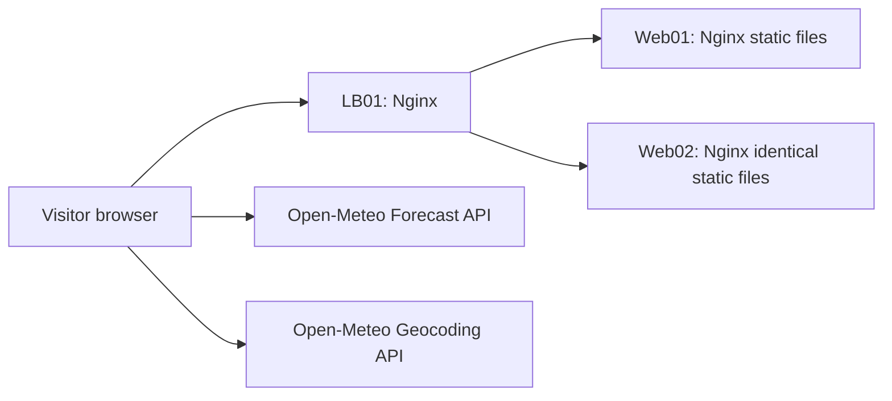

# WeCast Rwanda

WeCast Rwanda is a web application that helps people find times to spend outdoors using weather forecasts. You search for a location in Rwanda, choose a day and activity duration, and set the highest rain chance you're comfortable with.

The Overview shows current conditions, hourly weather, and three-day outlook. The activity planner lets users search locations in Rwanda and filter recommendations by day, duration, and maximum rain chance.

- Live app: [WeCast Rwanda (www.agermain.tech)](https://www.agermain.tech/)
- Demo video: [WeCast Rwanda App](https://youtu.be/9dXy87yYQak)

**Note**: In this activity I used agermain.tech as domain because it is the one that I currently own only, but I will buy another one specifically for WeCast later.

## Stack
- HTML, CSS and JavaScript.
- open-Meteo Forecast and Geocoding APIs.
- Nginx on the two web server, with Nginx round-robin balancing on LB01, once those servers are available.
- Git/GitHub for verison control and submission.
- Node.js only for including development server and automated checks; it is not a production application backend.


## Run locally

From the project folder, start the Node.js development server and open http://127.0.0.1:4173.

```bash
node scripts/serve.mjs
```

or use python inside WeCast directory:
```sh
python -m http.server 4173 --bind 127.0.0.1 --directory public
```

WeCast uses HTML, CSS, and JavaScript. The browser calls Open-Meteo directly through it's API.
`Run node --test` to check forecast parsing, request error handling, caching, and recommendation logic. The local test run passed 26 of 26 tests.

## Features

- Kigali overview with current model estimates, precipitation probability for the current hour, six upcoming hourly intervals, and a three-day forecast.
- Quick location choices for Kigali, Musanze and Huye. Huye falls back to a Butare search if no result is returned for Huye.
- Rwanda-only place search with explicit result selection, including administrative-area labels.
- Planning-day, duration (one to three hours) and maximum-rain-chance controls.
- Up to three distinct, non-overlapping recommended windows.
- Loading, no-results, no-window, timeout, API-rate-limit, invalid-response and connection-error messages.
- Ten-minute in-memory caching, periodic refresh and manual refresh.
- Responsive pages, labeled controls, keyboard focus, skip links and text descriptions for weather values.
- Shareable links retain the location and planner filters. Settings are not saved as a user profile.

## Recommendation rules

1. Use only full hours that have not started yet, within the selected Rwanda date and 06:00–18:00 planning hours.
2. Require a contiguous sequence matching the chosen duration. Never join hours across gaps or dates.
3. Every hour must have a known rain probability, temperature, wind speed and WMO weather code.
4. Each hour must satisfy the user's rain limit, temperature 12–32°C and wind at most 25 km/h. Forecast thunderstorms (codes 95, 96 and 99) are excluded.
5. Rank by lowest peak hourly precipitation probability, then lowest average hourly probability, lower peak wind, and earlier start.
6. Select at most three non-overlapping windows. If none qualifies, explain that honestly.

The fixed temperature and wind thresholds are design choices for comfort. They are not official meteorological safety thresholds. Precipitation probabilities are forecasts, not guarantees. A displayed peak of 20% means no included hour exceeds 20%; it is **not** the probability of any precipitation anywhere in the whole multi-hour window.

### Correct timing

All formatting uses `Africa/Kigali`. Requests use Unix timestamps, Celsius and km/h explicitly.

Open-Meteo's hourly precipitation probability describes the **preceding hour**. For a returned timestamp of 15:00, WeCast associates that probability with 14:00–15:00. Hourly temperature and wind are instantaneous samples at the returned timestamp, so the interface explains that they are sampled at the interval's end. Current temperature and wind use the separate `current` response, rather than labeling an hourly forecast as a live observation.

Source: [Open-Meteo Forecast API documentation](https://open-meteo.com/en/docs).

## API integration

### Forecast

`GET https://api.open-meteo.com/v1/forecast`

Parameters include:

```text
latitude, longitude
timezone=Africa/Kigali
timeformat=unixtime
forecast_days=3
temperature_unit=celsius
wind_speed_unit=kmh
hourly=temperature_2m,precipitation_probability,wind_speed_10m,weather_code,is_day
current=temperature_2m,wind_speed_10m,weather_code,is_day
daily=temperature_2m_max,temperature_2m_min,weather_code
```

### Location search

`GET https://geocoding-api.open-meteo.com/v1/search`

`name`, `countryCode=RW`, `count=8`, `language=en`, `format=json`.

Location coverage depends on the upstream index. Missing results do not imply that a place does not exist. Geocoding requests happen on explicit search submission rather than every keystroke.

Documentation: [Forecast API](https://open-meteo.com/en/docs), [Geocoding API](https://open-meteo.com/en/docs/geocoding-api).

### Access and limits

Open-Meteo's non-commercial endpoints do not require an API key. The free service is intended for non-commercial use and has rate limits. The documentation and terms should be reviewed again before commercial reuse. The implementation uses explicit search, a ten-minute cache and no background retry loop after failures to avoid unnecessary calls. HTTP 429 asks the visitor to wait.

Official sources: [terms](https://open-meteo.com/en/terms), [API access parameters](https://open-meteo.com/en/docs).

## Data attribution and design sources

- Weather forecasts: [Open-Meteo](https://open-meteo.com/), under [CC BY 4.0](https://creativecommons.org/licenses/by/4.0/).
- Location data: [GeoNames](https://www.geonames.org/), through Open-Meteo's Geocoding API.
- WeCast processes the forecasts into activity-window rankings; these rankings are not an Open-Meteo product or endorsement.
- The design was adapted from three user-supplied reference screenshots: a detailed weather dashboard, a seven-tone graphite palette, and a weather overview. Add the original creators' links here if available before submitting.
- The weather illustration is constructed with CSS. The small SVG icons are included in `ui.js`; no reference screenshot is shipped as a product asset.

Open-Meteo attribution requirements: [licence page](https://open-meteo.com/en/licence).

## Architecture



Nginx serves the HTML, CSS and JavaScript. The browser fetches weather data directly from Open-Meteo. Load balancing keeps static pages available when one web server fails; it does not remove the separate dependency on the weather API.

## Weather data and recommendations
| API | Purpose in WeCast |
| --- | --- |
| [Open-Meteo Forecast API](https://open-meteo.com/en/docs) `/v1/forecast` | Retrieves current conditions and three days of hourly and daily forecasts for the selected coordinates. |
| [Open-Meteo Geocoding API](https://open-meteo.com/en/docs/geocoding-api) `/v1/search` | Finds places using country code, eg = RW, and returns coordinates for the forecast. |

The planner looks for consecutive hours between 06:00 and 18:00 Rwanda time. Each hour must meet the selected rain limit, have a temperature of 12-32°C and wwind of at most 25 km/h, and have no forecast thudnerstom. The best match has the lowest peak hourly rain chance. The interface shows a message when no location or suitable window is found.

Open-Meteo's free non-commercial service requires no API key and lists limits of 600 calls per minute, 5000 per hour, and 10,000 per day. WeCasr caches API responses for ten minutes. Visitors need no login. Keep environment files and private keys out of Git using `.gitignore`. [Open-Meteo terms](https://open-meteo.com/en/terms)

Forecast data is provided by Open-Meteo under CC BY 4.0. Location data comes from GeoNames through Open-Meteo. WeCast transforms the forecast data into activity recommendations. [Data sources and license](https://open-meteo.com/en/licence)

## Deployment

**Note:** For more detailed instruction for deployment [Check here](/deploy/README.md)

#### Web01 and web02
Copy the same `Public/` directory  to `/var/www/wecast-rwanda/public/` on each server. 
Configure Nginx to listen on port 80 for `server_name wecast.internal`, with that directory as its root and index.html as its index. 
Set `X-Served-By` to `Web01` or `Web02` on the respective server. 
Run `sudo nginx -t`
Then `sudo nginx -s reload`

#### LB01 
In the existing HTTPS frontend in `/etc/haproxy/haproxy.cfg`, the public homepage redirects to `/wecast` with `302`. The `/wecast/` route selects `wecast_out`, which removes the prefix and sends the `Host` header expected by both Nginx sites.

```haproxy
backend wecast_out
    mode http
    balance roundrobin
    http-request replace-path ^/wecast/(.*)$ /\1
    http-request set-header host wecast.internal
    server web01 WEB01_PRIVATE_IP:80 check
    server web02 WEB02_PRIVATE_IP:80 check
```

**Note:** I got the private ip address by `hostname -I`

Use the assigned private addresses in the backend.
Validate with `sudo haproxy -c -f /etc/haproxy/haproxy.cfg`
Then run `sudo systemctl reload haproxy`

## Verification

```sh
npm test
npm run check:api
```

The offline tests cover recommendation boundaries, timezone handling, missing data, malformed responses, cache behavior and request failures. The live API check also inspects CORS headers. Manual cases and honest verification status are in `[here](docs/evidence/lb01-20261122T215858Z.txt)`.


## Challenges and limitations

- Precipitation timing required deliberate interval alignment; see the explanation above.
- Null and unknown weather values must remain unavailable rather than becoming zero-risk recommendations.
- Geocoding may use alternate city names. Search nearby places or alternate spellings when needed.
- Local automated tests passed at preparation time, but this environment could not resolve the external API hosts. A real API and browser check on your computer remains necessary.
- The servers have not been issued, so Nginx deployment, TLS, traffic distribution and failover remain unverified.
- Forecast quality is dependent on the upstream models. The planner does not evaluate flooding, road conditions or every hazard relevant to an outdoor activity.

After deployment, replace pending notes with actual challenges, fixes and evidence. After the class submission, optional accounts, saved preferences, schedules and reminders can be designed as a separate extension.

